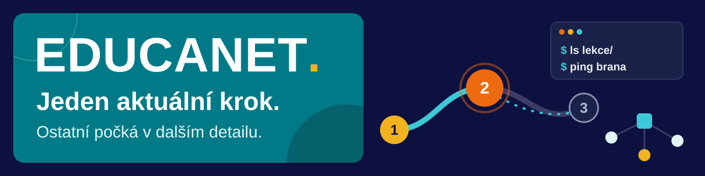
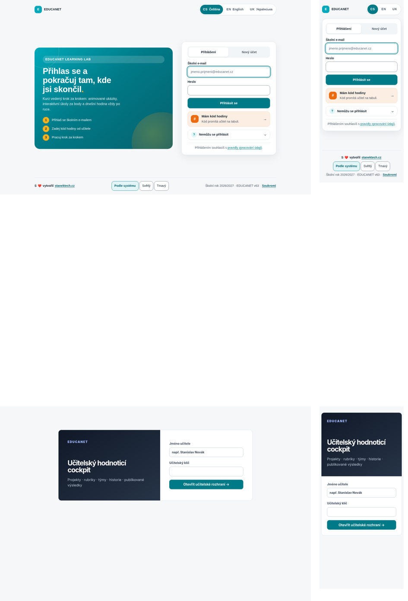
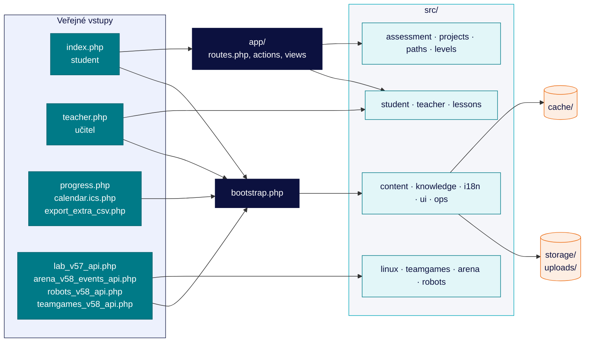

<p align="center">
  
</p>

<p align="center">
  
  
  
  
</p>

# EDUCANET / Quiet Study

Školní aplikace pro výuku grafiky, webdesignu, operačních systémů a počítačových sítí ve třídách 1.A až 4.A. Quiet Study je studentské rozhraní, které ukazuje jeden doporučený krok a podrobnosti otevírá až na vyžádání.

**Pro koho.** Student v [index.php](index.php) najde lekce, kalendář, materiály, procvičování, projekty a vlastní pokrok. Učitel v [teacher.php](teacher.php) připravuje hodiny, spravuje přístupy, sleduje práci třídy a hodnotí projekty. Data leží v souborovém JSON úložišti, databáze není potřeba.

<p align="center">
  
</p>

## Co aplikace umí

| | |
| --- | --- |
| **Lekce a hodina** | Model lekcí se schvalováním, Dnešní hodina, kód hodiny pro připojení třídy, tutoriály a vizuální laboratoře. [src/lessons/](src/lessons/) |
| **Linux Lab** | Simulovaný terminál s příkazy a úrovněmi, bez externího brokeru. Učitel má k labu vlastní nástroje. [src/linux/](src/linux/) |
| **Projekty** | Projektové pracoviště, týmy a role, evidence práce a recenze spolužáků. [src/projects/](src/projects/) |
| **Hodnocení** | Testy, úlohy, kompetence, dovednosti a vazba na ŠVP. [src/assessment/](src/assessment/) |
| **Hry a aréna** | Aréna, týmové hry, kvízové banky a robotí liga. [src/arena/](src/arena/), [src/teamgames/](src/teamgames/), [src/robots/](src/robots/) |
| **Učitelský cockpit** | Přípravy hodin, účty a oprávnění, přehledy tříd a co je potřeba dnes vyřešit. [src/teacher/](src/teacher/) |

Rozhraní je v češtině, angličtině a ukrajinštině ([src/i18n/](src/i18n/), [lang/](lang/)). Světlý a tmavý režim se řídí nastavením zařízení, student ho může přepnout ručně.

## Rychlý start

Potřebuješ PHP 8.1 nebo novější s rozšířeními `json`, `session`, `fileinfo` a `mbstring` (viz [INSTALL.md](INSTALL.md) a [tools/check_install.php](tools/check_install.php)). Do `storage/` a při používání příloh i do `uploads/` musí uživatel PHP zapisovat.

Z kořene projektu:

```bash
read -rsp 'Dočasný učitelský klíč: ' EDUCANET_TEACHER_EXPORT_KEY
echo
export EDUCANET_TEACHER_EXPORT_KEY
php tools/build_runtime_cache.php
php tools/check_install.php
php -S 127.0.0.1:8090
```

- Student: `http://127.0.0.1:8090/`
- Učitel: `http://127.0.0.1:8090/teacher.php`, přihlášení jménem a klíčem zadaným výše.

Bez nastaveného klíče vrací učitelská stránka záměrně HTTP 503, výchozí heslo v repozitáři není. Po vypnutí serveru proměnnou smaž (`unset EDUCANET_TEACHER_EXPORT_KEY`).

Zkoušej na kopii aplikace i s kopií `storage/`. `EDUCANET_STORAGE_DIR` přesměruje úložiště, cache a ostatní zapisované soubory ale neizoluje. `EDUCANET_DEV_BYPASS=1` zapíná lokální vývojový vstup a v produkci zůstává vypnutý.

## Jak je aplikace poskládaná

Každý veřejný vstup nejdřív načte `bootstrap.php`. Ten připraví úložiště, překlady, učitelské účty a obsah kurikula. Studentská část jde dál přes router v `app/`, učitelská a API vstupy si moduly ze `src/` načítají samy.



Studentské pohledy vybírá parametr `?view=…`, učitelské záložky `teacher.php?tab=…`. Registry najdeš v [app/routes.php](app/routes.php) a [src/teacher/teacher_v58.php](src/teacher/teacher_v58.php). Čísla v názvech souborů (`_v58`, `_v78` …) označují vrstvy, ve kterých soubor vznikl, ne samostatná vydání.

## Mapa složek

```text
./           veřejné vstupy, bootstrap.php, PWA (sw.js, manifest.webmanifest) a dokumenty vydání
src/         interní knihovny, obsah a pohledy podle oblastí
app/         router, obsluha akcí a segmenty studentských stránek
assets/      CSS, JavaScript, ikony a lokální knihovny
lang/        překladové katalogy
materials/   výukové materiály a podklady pro učitele
storage/     provozní data
private/     neveřejné soubory; skutečná tajemství patří mimo web root
uploads/     studentské přílohy
cache/       odvozená cache (runtime, model lekce)
migrations/  migrace dat
tools/       CLI správa, sestavení vydání a audity
docs/        provozní dokumentace, vzory nasazení a výsledky kontrol
```

## Quiet Focus

Pravidla, podle kterých je postavené studentské rozhraní ([docs/DESIGN_SYSTEM_V78.md](docs/DESIGN_SYSTEM_V78.md)):

- Domů má přednost karta Dnes s jedním aktuálním krokem a na stránce je nejvýš jedno plné primární tlačítko.
- Upozornění jsou sbalená. Nápověda se otevírá nativně a funguje i bez JavaScriptu.
- Pokrok ukazuje nejdřív lekce, témata a projekty. Kruh, cíle a výzvy jsou až pod `Další detail`, XP v Menu účtu.
- Na Domů nejsou série dní ani jiné tlačení do aktivity.
- Barvy jdou jen přes tokeny v `assets/tokens-v78.css`. Text má nejméně 14 px, cíl dotyku 44 px a stav se nikdy nesděluje jen barvou.

Barvy vycházejí z identity školy: tmavě modrá `#0c113f`, tyrkysová `#00a8b9` (v tmavém režimu `#3cc8d6`), žlutá `#f3b21f` a oranžová `#ec6b10`.

## Nasazení na aaPanel

Celý postup je v [docs/NASAZENI_AAPANEL.md](docs/NASAZENI_AAPANEL.md), vzory konfigurace v [docs/deploy/aapanel/](docs/deploy/aapanel/). Hodnoty ve vzorech si správce upraví pro svůj web.

1. Připrav PHP a zapisovatelné datové adresáře. Učitelský klíč patří do prostředí PHP-FPM nebo do souboru mimo veřejný kořen ([ADMIN_ACCESS.md](ADMIN_ACCESS.md), proměnná `EDUCANET_SECRETS_FILE`). Do Gitu ani do vydání se nedává.
2. `EDUCANET_APP_URL` nastav na veřejnou HTTPS adresu kvůli ověřovacím e-mailům a obnově hesla. Zálohy směřuj přes `EDUCANET_BACKUP_DIR` mimo veřejný kořen.
3. Vydání sestavíš příkazem `php tools/build_release.php --out=<adresar-vydani> --lint --zip`. Před aktualizací zazálohuj data i kód. Deploy skript nejdřív ukáže náhled, skutečné nasazení spouští přepínač `--apply`.
4. Nahraj i celou složku `src/`. Nginx `.htaccess` nečte, proto použij dodané pravidlo, které zakazuje přístup do `src/` a dalších interních adresářů. Apache musí respektovat kořenový i vnořené `.htaccess`.
5. Proveď migrace, sestav cache, spusť `php tools/check_install.php`, `php tools/preflight.php` a HTTP kontrolu. Nakonec obnov OPcache nebo reloadni PHP-FPM pool.

**PATCH** nesmí přepsat ani smazat `storage/`, `private/`, `uploads/` ani `cache/`. Aktualizace kódu neobnovuje data. Migrace dat a sestavení cache jsou samostatné kroky, které se spouštějí vědomě.

## Testy

Syntaxe všech PHP souborů:

```bash
find . -type f -name '*.php' -not -path './.git/*' -print0 | xargs -0 -n1 php -l
```

Všechny audity najednou spustíš v testovací kopii přes `php tools/run_audits.php --since=all`. Runner si vytváří dočasné kopie úložiště a některé audity sestavují cache nebo spouštějí HTTP server. Přepínače jsou popsané v [tools/run_audits.php](tools/run_audits.php).

Při změně struktury porovnej stav před a po:

```bash
node tools/structure_http_2026_10_29.cjs before
node tools/visual_qa_2026_10_29.cjs structure-before
# po úpravě kódu
node tools/structure_http_2026_10_29.cjs after
node tools/visual_qa_2026_10_29.cjs structure-after
```

Oba nástroje kopírují aplikaci do izolované složky a používají port 8090, takže je pouštěj postupně. Potřebují Chromium a nainstalovaný Playwright; cestu k němu určuje import ve skriptu a v jiném prostředí ji upravíš. Do produkce nepatří.

HTTP kontrola porovnává stavy a přesměrování pro návštěvníka, studenta i učitele a hlídá PHP log. Formuláře najde, ale POST neodesílá. Vizuální test prochází 52 zobrazení a 72 interakcí ve světlém i tmavém režimu na šířkách 1440 a 390 px. Poslední běh skončil 52/52 a 72/72 ([docs/TEST_2026-10-29.md](docs/TEST_2026-10-29.md)). Mapa přesunů souborů je v [docs/STRUKTURA_2026-10-29.md](docs/STRUKTURA_2026-10-29.md).

## Changelog

Zkráceně, podrobnosti jsou v [docs/](docs/). `RELEASE_MANIFEST.json` nese označení v59 ze 14. 10. 2026 a novější vrstvy až po v81 popisují dokumenty v `docs/`.

| Kdy | Změna |
| --- | --- |
| 29. 10. 2026 | Interní PHP moduly přesunuty do `src/`, veřejné URL zůstaly. Oprava Quiet Focus, kontrastu a mobilního ovládání. |
| v78–v81 | Design systém s tokeny pro světlý a tmavý režim, nový vizuální jazyk cockpitu a Domů. |
| v58–v66 | Identita a přechod školního roku, týmové hry, robotí liga, překlady, projekty, kompetence a hodnocení. |
| v50.x | Quiet Focus, volba studijního cíle, hands-on laboratoře, Skill Passport. |
| v41–v48 | Mastery Learning, adaptivní sady lekcí, Learning Studio, vizuální simulace, praktické laboratoře pro 3.A. |
| v24–v35 | Projektové pracoviště, adaptivní učení, školní rok 2026/2027, runtime cache, instalace přes CLI. |
| září 2026 | Kurikulum pro čtyři třídy, znalostní knihovna, grafické studio, školní účty, export výsledků, XP a odznaky. |

## Licence

Repozitář licenci neuvádí. Knihovny v `assets/vendor/` mají vlastní licenční podmínky.

## English summary

EDUCANET / Quiet Study is a PHP school learning app for students and teachers at EDUCANET Brno. Public entry points stay at the project root, internal modules live in `src/`, and student routing lives in `app/`. Data is stored in JSON files under `storage/`. These notes describe the repository, not a verified live deployment. Keep runtime data and secrets intact during updates.
